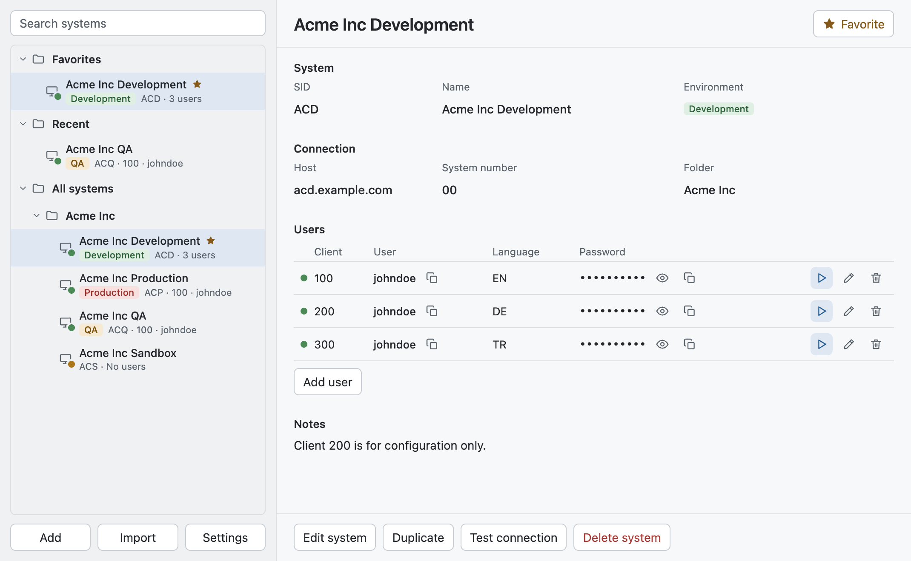

# SAP GUI Launcher

A desktop app for macOS (Apple silicon), Windows and Linux that opens SAP GUI already logged in to the system you pick.

> Not affiliated with or endorsed by SAP SE. SAP and SAP GUI are trademarks of SAP SE.



## Features
- Import direct application-server systems from the SAP Logon landscape file, with their folders. A new import adds new systems and keeps your users and notes.
- Save several users per system, each with client, user, password and language. A green dot means ready to launch, yellow means something is missing.
- Launch a user with the launch icon (▶) in its row.
- Launch from the tray / menu-bar menu: favorites, recently used, and all systems that have users, in their folders. If a launch fails, the window opens and shows the error.
- Search by system name, SID, client, user or folder.
- Fixed folders in the list: **Favorites**, **Recent** (the last five used systems that are not favorites) and **All systems**. A favorite system has a star next to its name.
- Your own folders: **Add**, then **Folder**. Drag systems and folders to another folder, or use their edit forms. Imported folders work the same way. Import does not move a system out of a folder you chose.
- Environment label (Development, QA, Production) and notes per system.
- Password generator, copy buttons for user and password, and **Test connection**.
- **Duplicate** copies a system with its users. You can change the copy before you save it.
- Every deletion asks first. Deleting a folder moves its content one folder up; no system is deleted.
- Light and dark theme, or the theme of the system, under **Settings**.
- Offers a new version when one is released and installs it when you click **Update now**.

## Install
Download the file for your system from the [latest release](https://github.com/tariktekin8/sapgui-launcher/releases/latest). Each installer has a `.sha256` checksum next to it.

The app is not signed with a paid certificate, so your system warns you the first time.

### macOS
1. Download `SAP.GUI.Launcher_<version>_aarch64.dmg` (Apple silicon) and drag the app into **Applications**.
2. Open it. macOS says it cannot check the app.
3. Open **System Settings → Privacy & Security**, scroll down and click **Open Anyway**.

Or run this once instead of steps 2–3:

```bash
xattr -dr com.apple.quarantine "/Applications/SAP GUI Launcher.app"
```

### Windows
1. Download `SAP.GUI.Launcher_<version>_x64-setup.exe` (or the `.msi`) and run it.
2. If SmartScreen appears, click **More info → Run anyway**.

### Linux
- **AppImage:** download it, then `chmod +x SAP.GUI.Launcher_*.AppImage` and run it.
- **Debian/Ubuntu:** `sudo apt install ./SAP.GUI.Launcher_<version>_amd64.deb`
- **Fedora/RHEL:** `sudo dnf install ./SAP.GUI.Launcher-<version>-1.x86_64.rpm`

Linux support is not tested yet.

## First steps
1. SAP GUI must be installed. The app looks for it in the default place:
   - macOS: `/Applications/SAP Clients/SAPGUI <version>/`
   - Windows: `C:\Program Files\SAP\FrontEnd\SAPGUI\`, then the same folder under `C:\Program Files (x86)\`
   - Linux: `/opt/SAPClients/SAPGUI<version>/`

   If **Settings** shows "Not found", click **Choose file…** there. Choose `sapshcut.exe` on Windows, the SAPGUI app on macOS or the `sapgui` file on Linux.
2. Click **Import** to read your systems from SAP Logon, or **Add** to enter one.
3. Add a user: fill in client, user and password, and **Save**. The form opens by itself when you save a system you added. For an imported system, select it and click **Add user**.
4. Click the launch icon (▶) next to the user.

Closing the window keeps the app in the tray (Windows, Linux) or menu bar (macOS). Use **Show window** in that menu to open it again and **Quit** to exit. On macOS the Dock icon also opens it.

## Your data
Systems, folders, passwords and the SAP GUI path are stored in one file. On macOS and Linux only your user can read it; on Windows it has the permissions of your `AppData` folder:

- macOS: `~/Library/Application Support/sapguilauncher/systems.json`
- Windows: `%APPDATA%\sapguilauncher\systems.json`
- Linux: `~/.config/sapguilauncher/systems.json`

**Passwords in this file are not encrypted.** Anyone who can log in as you, or read your backups, can read them.

**The password is passed to SAP GUI on its command line.** Other programs on the same computer may be able to see it there while SAP GUI starts or runs.

A copied password is removed from the clipboard after 30 seconds, or when you quit the app before that. It stays if the app is ended by force. The app asks clipboard history tools not to keep it, but a tool can ignore that. Closing the window hides passwords that are shown.

On macOS and Linux, a value with `&` cannot be passed to SAP GUI, so the app shows an error instead of launching. A password with `=` may not work yet.

## Updates
At start the app checks the latest release on GitHub. When there is a newer one, the sidebar shows **Update now**. Click it, and the app downloads the new version, checks its signature, installs it and restarts. A `.deb` or `.rpm` install asks for the administrator password. If the update fails, the app links to the release page so you can install it by hand.

## Build from source
Needs Node.js 24 and Rust (stable). On Linux also the [Tauri system packages](https://tauri.app/start/prerequisites/).

```bash
cd app
npm ci
npm run tauri dev     # run with live reload
npm run tauri build   # build installers
```

Rust tests: `cd app/src-tauri && cargo test`

## Release
The version lives only in `app/package.json`.

```bash
cd app && npm version 1.1.0 --no-git-tag-version
```

Commit, then push `main` and a tag such as `v1.1.0`. GitHub Actions builds all installers into a draft release. Publish the draft; from then on installed apps offer the update. A published version is never rebuilt, so raise the version for every release.

## License
[MIT](LICENSE) © 2026 Tarık Tekin
